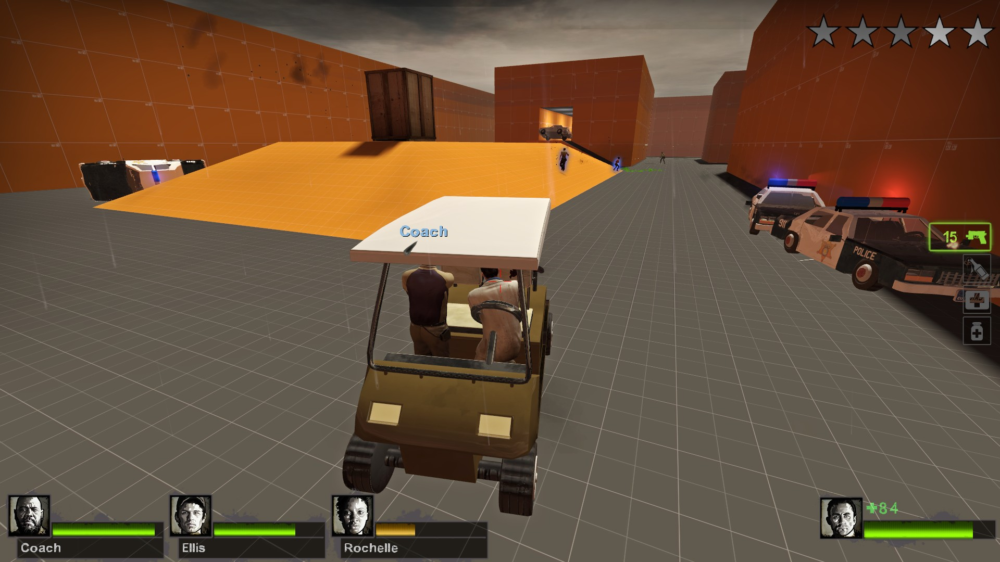
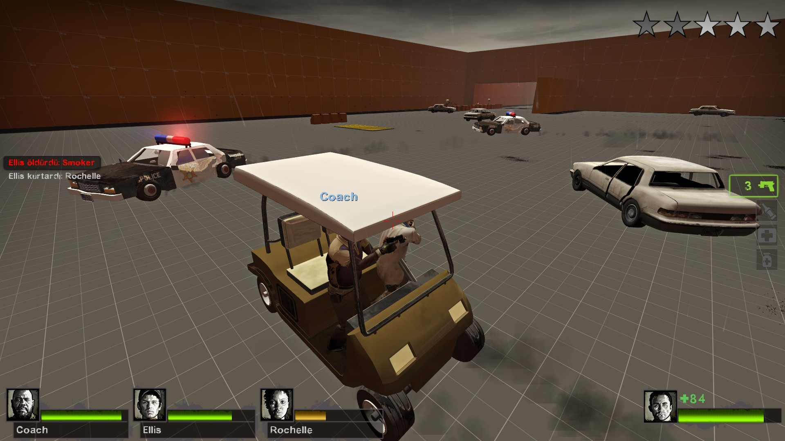
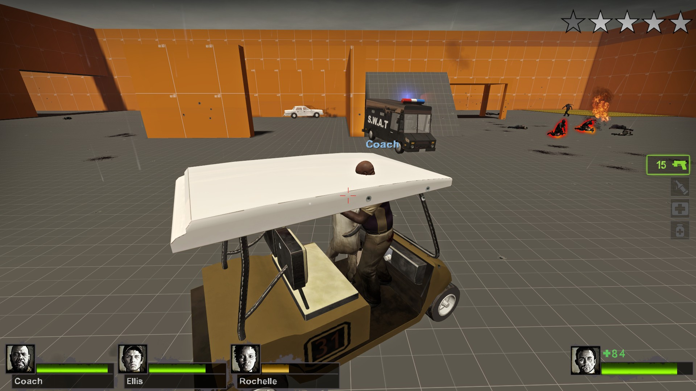
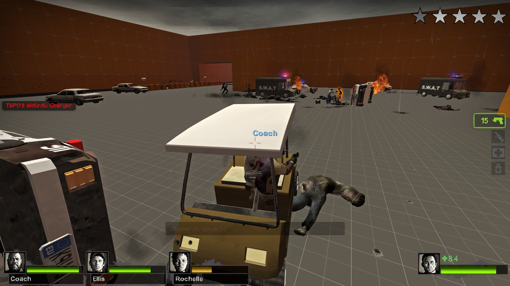
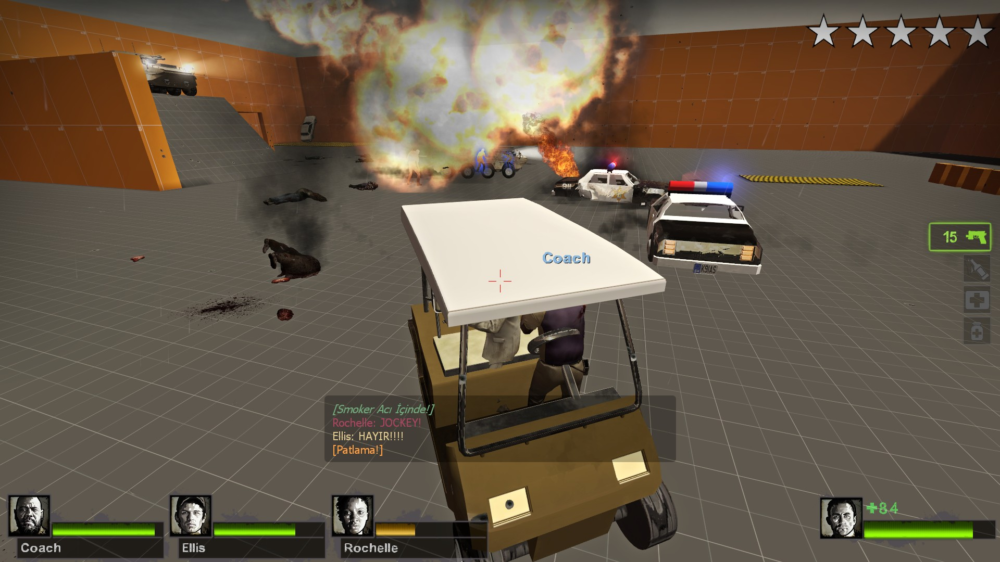
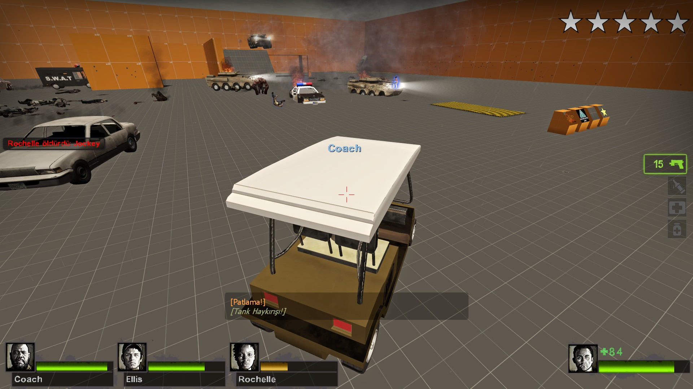
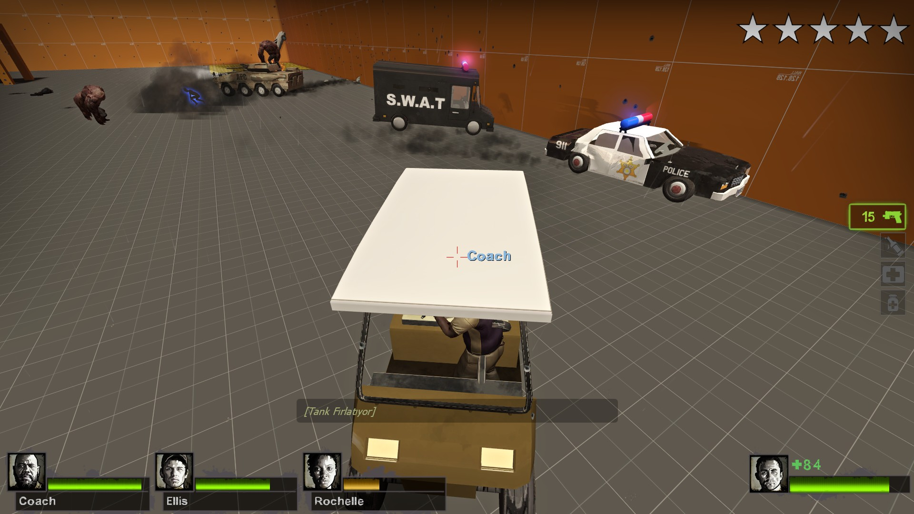

# Grand-Dead-Auto-VScript
L4D2 VScript mod that includes driveable vehicle, wanted level system and police AI

# Features:
- Driveable cars
- 1-4 seat support
- Fuel system
- Radio Station system
- Wanted level system
- Hostile AI (Police)
- Fleeing/Coward AI (can be used for custom scenarios)
- Neutral/Freeroam AI (can be used for detailing)
- Nav mesh spawning and despawning
- Marking forbidden spawn areas and forbidden paths as "NOTHREAT" Left 4 Dead 2 Nav Attribute.
- **NEW**: Added "Traffic Director", adds random civil/neutral vehicles around the map when is active!

# Yet to be added:
- .vmf instance of how to make your own vehicles both player controllable vehicle and NPC only vehicle
- model and texture files
- sound files

# Images

